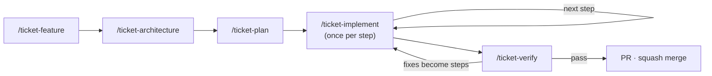

# Spec-driven development

How a change goes from an idea to a merged PR in this repo, and what each `/ticket-*` skill does
under the hood. The binding constraints for agents live in
[.claude/rules/sdd.md](../../.claude/rules/sdd.md); this document explains them.

Every artifact lives in a ticket folder named by `.claude/rules/sdd.md`, started from
[docs/tickets/_template/](../tickets/_template/feature.md). The glossary is
`docs/knowledge/glossary.md`, created when the first term is settled.

The "code" here is config, so a step proves itself without tests: a validator in
`scripts/check.sh` that turns red on bad input, a probe file or command that fails before the step
and passes after, or a keypress with the result to expect. A keypress is the one kind of evidence
no agent can produce: you press it, and the observed result is recorded.

## When to run which cycle

| Change | Cycle |
|---|---|
| A new tool, plugin or keybind, a key that moves between layers, or any choice a reviewer could question | the full cycle |
| A broken key or a small change with no new decision and an existing Seam to prove it at | `/ticket-feature` with a few requirements, then `/ticket-plan`, `/ticket-implement`, `/ticket-verify`; skip `/ticket-architecture` |
| A typo, a version bump, a doc fix | no ticket: one commit with the tool or area as its scope (`nvim`, `docs`, `meta`) |

## The five skills

All five are typed by you (`disable-model-invocation: true`) and run in the main session, because
grilling, plan review and commit approval need you. Each takes the ticket folder, except
`/ticket-feature`, which takes a slug.

| Skill | Input | You decide | Output |
|---|---|---|---|
| `/ticket-feature <slug> [idea]` | an idea, notes or a link | the answers to each grilling round; the terms | `feature.md` with EARS requirements; glossary entries |
| `/ticket-architecture <ticket>` | `feature.md` | the Seams and the Decisions | `architecture.md` |
| `/ticket-plan <ticket>` | `feature.md`, `architecture.md` | the plan as a whole: the heavy review | `plan.md` with steps and coverage |
| `/ticket-implement <ticket> [step]` | the next unblocked step | approve, give feedback, or stop | one commit per approved round |
| `/ticket-verify <ticket>` | the branch against `origin/main` | which simplifications and lessons to apply; whether to open the PR | `verification.md` |

`/check` stays beside them: it runs `scripts/check.sh` and reports each validator's result. Agents
may run it on their own.

## Under the hood

The skills are thin wrappers over the [mattpocock-skills](https://github.com/mattpocock/skills)
plugin, which the project enables in `.claude/settings.json` (and turns `superpowers` off, which
would push its own process and paths beside them). The wrappers decide **where** files go and
**when** you decide; the plugin decides **how** to interview, model, design and review. Its skills
are referenced by name and never copied, so plugin updates arrive on their own.

### Dependency map

What each skill and agent uses, read from their files. A commit that changes what a skill or agent
uses updates this map too.

| Skill or agent | Plugin skills | Spawns | Hook | Writes |
|---|---|---|---|---|
| `/ticket-feature` | `grilling`, `domain-modeling` | `researcher` | — | `feature.md`, `docs/knowledge/glossary.md`, `docs/knowledge/roadmap.md` |
| `/ticket-architecture` | `codebase-design`, `grilling` | `researcher` | — | `architecture.md` |
| `/ticket-plan` | — | `researcher` | — | `plan.md` |
| `/ticket-implement` | `code-review` | `implementer` (one worktree per parallel step), `reviewer` | `check.sh`, through `implementer` | `plan.md`, `architecture.md`, one commit per approved round |
| `/ticket-verify` | `code-review` | `verifier`, `reviewer` | — | `verification.md` |
| `/check` | — | — | — | nothing: runs `scripts/check.sh` |
| `implementer` | — | — | `.claude/hooks/check.sh` on `Stop` (runs as `SubagentStop`) | the step's files |
| `reviewer` | — (spawned by `code-review` for one axis) | — | — | nothing: read-only |
| `verifier` | — | — | — | nothing: read-only |
| `researcher` | — | — | — | nothing: read-only |

Plugin skills are `mattpocock-skills:<name>`; ticket files are in `docs/tickets/<ticket>/`.

### What the wrappers override, and why

| Plugin behaviour | Override | Why |
|---|---|---|
| `domain-modeling` writes `GLOSSARY.md` at the root and ADRs to `docs/adr/` | glossary in `docs/knowledge/glossary.md`; ADR candidates become open questions, then `D…` decisions | one docs tree; decisions stay next to the ticket that made them |
| `to-spec` and `to-tickets` publish to an issue tracker or `.scratch/`, as user stories | `/ticket-feature` and `/ticket-plan` write EARS requirements and steps into the ticket folder | artifacts are reviewed and committed with the config |
| `tdd` drives a change through unit tests at seams the user confirms | not used: the implementer proves its step at a Seam from `architecture.md › Seams` with a validator, a probe or a keypress | a config repo has no unit tests, and a subagent cannot ask; the Seams were agreed earlier |
| `implement` commits on its own and reviews committed work | `/ticket-implement` reviews the uncommitted step and commits only after your OK | every commit is approved |
| `code-review` diffs from a fixed point to `HEAD` and spawns generic sub-agents | for a step: `git diff HEAD` plus untracked files, reviewed by read-only `reviewer` agents; the Spec axis also flags a diff that changes what a requirement asks | the step is reviewed before it is committed, by agents without Edit or Write, told never to edit, and `feature.md` changes with the requirement |
| `research` writes a notes file into the repo | `researcher` answers in its report | facts reach the conversation, not the tree |

## The approval gate

Nothing is committed until you say so. The stages, the rounds and what approval writes are in
[.claude/rules/sdd.md](../../.claude/rules/sdd.md) and `/ticket-implement`; your part in each step:

- **Press the keys** the implementer's report lists and compare what happens with the result it
  expects. No agent can press a key, so only you can show that a binding does what it should.
- **Read the report and both reviews**, Standards and Spec, kept apart so one cannot hide the other.
- **Decide:** approve, send feedback to the same implementer after the main session offers to
  commit the current round, or stop. A report that starts with `BLOCKED:` is a question only you
  can answer.

Pushing and opening the PR each need their own OK.

## Roadmap and history

A ticket starts as an entry in [the roadmap](./roadmap.md), which says what an entry holds and how
`/ticket-feature` picks it up, and ends as one squash commit on `main`, whose body is the PR
description: a reference guide to the config it added (`.claude/rules/pull-requests.md`). The
*how*, step by step, stays in two places that outlive the ticket branch: the merged PR's commit
list on GitHub, one commit per approved round, and the ticket folder's `plan.md` with each step's
findings. Every commit of a ticket names its folder in `Refs:` (`.claude/rules/commits.md`).

Commits made before this loop cite their spec in `Refs:` as a link; that history is not carried
into `docs/tickets/`.

## Lessons

`/ticket-verify` ends with **Lessons**: mistakes that recurred in two or more steps, each with one
proposed change to a skill, a rule or a check; the skill says how they are chosen. You decide which
to apply, and nothing is applied without your OK.

## Periodically

`/mattpocock-skills:retro` reviews a whole session and suggests changes to rules, checks and
skills. The plugin marks it user-invoked, so run it by hand; its findings go through the same OK as
Lessons. The plugin's `improve-codebase-architecture` looks for shallow code modules, which a
config repo does not have, so it is not part of this loop.

## After a plugin update

The plugin updates itself, so its behaviour can shift under the wrappers. After an update:

1. Read the plugin's changelog or diff for `grilling`, `domain-modeling`, `codebase-design` and
   `code-review`, the skills the map above delegates to.
2. Check that each override in the table above still targets something the skill does; a renamed
   file or step makes the override silently stale.
3. Run `/ticket-feature` on a throwaway slug in a scratch clone outside `~/.claude/` and settle one
   term. It must land in `docs/knowledge/glossary.md`, with no `GLOSSARY.md` or `docs/adr/`.
4. Record what changed as a lesson, or as a fix to the wrapper.

## Troubleshooting

| Symptom | Cause | Fix |
|---|---|---|
| `/ticket-*` is not offered when typing `/` | Claude Code was started outside the repository root | start it in the root; the skills live in `.claude/skills/` |
| plugin skills are missing, or `superpowers` is active | the plugin is not installed, or the session predates `enabledPlugins` | install `mattpocock-skills` from `claude-plugins-official` and restart the session |
| `implementer` never stops | `scripts/check.sh` stays red and the agent keeps fixing | stop it; resume with guidance, or let it report `BLOCKED:` |
| the implementer waits minutes after its last edit | the hook's check runs the full Neovim load, which may bootstrap plugins | wait: the hook's timeout is set in `.claude/agents/implementer.md`; `scripts/check.sh` caps the Neovim load only when `timeout` or `gtimeout` is installed |
| the check hook never runs | the folder's workspace trust was never accepted (a `-p` session does not accept it) | open Claude Code interactively in the folder once and accept the trust dialog |
| the check is green but a section says `skip` | that tool is not installed on this machine, so its config was not loaded | `brew bundle` (`docs/install.md`), then run `/check` again before trusting the step |
| a `GLOSSARY.md` or `docs/adr/` appeared | a plugin skill fired outside `/ticket-feature` | move the terms into `docs/knowledge/glossary.md` and delete the file |
| a verifier or reviewer cites a rule that the file no longer says | the session started before the rule changed, and its agents carry the old copy | run `/ticket-verify` in a new session, or tell each agent to read rules from disk |
| the map above disagrees with a skill or agent file | the file changed without the map | trust the file, fix the map in the next commit |
