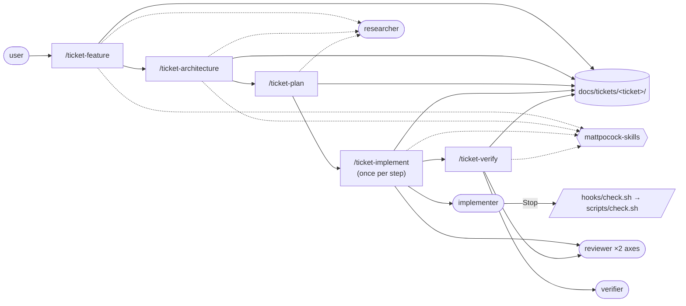

# SDD in git — architecture

> Ticket: `2026-10-30-2031_sdd-in-git` · Requirements: [feature.md](./feature.md)

## Overview

The Notion-bound toolkit is replaced by `app-template`'s, copied and adapted to a config repo. The
user types one of five phase skills; each runs in the main session, writes into the ticket folder,
asks the user every decision, and spawns agents only for work that needs no answer from the user.
The implementer is a real subagent now, so a `Stop` hook can hold it until the stack check is
green.



## Structure

**New**

- `docs/tickets/_template/` — `feature.md`, `architecture.md`, `plan.md`, `verification.md`.
- `docs/knowledge/sdd.md` — the human guide: when to run which cycle, the five skills, the
  dependency map, troubleshooting, what to do after a plugin update.
- `docs/knowledge/roadmap.md` — tickets not started; first entries: this ticket (linked to its
  folder) and the shared plugin of Q3.
- `.claude/skills/ticket-{feature,architecture,plan,implement,verify}/SKILL.md`.
- `.claude/skills/check/SKILL.md` — `/check`, moved from `.claude/commands/check.md` (D1).
- `.claude/agents/reviewer.md`.
- `.claude/hooks/check.sh` — the implementer's `Stop` gate.

**Rewritten**

- `.claude/agents/implementer.md`, `verifier.md`, `researcher.md` — `app-template`'s, with the
  stack's evidence (validators, keypresses) in place of tests and `make check`.
- `.claude/rules/sdd.md` — the gates only, behind `paths:`; the build contract of the Notion
  toolkit goes.
- `.claude/CLAUDE.md` — "How work happens" points at the skills and the guide; the Notion golden
  rule goes.
- `.claude/rules/commits.md` (scope = ticket slug, `Refs:` = ticket folder),
  `pull-requests.md` and `.github/PULL_REQUEST_TEMPLATE.md` ("Feature & ACs" → "Ticket &
  requirements"), `claude-md.md` (the toolkit section), `config.md` and `testing.md` (their
  `/sdd:` and spec pointers), `.claude/agent-patterns/commit-examples.md`.
- `.claude/settings.json` — `enabledPlugins` (D6).
- `README.md` § How this repo is built, `docs/guide.md`'s pointer, `claude/README.md`'s Notion MCP
  row, the `Brewfile` comments that call Notion the SDD hub.

**Deleted**

- `.claude/commands/` — the seven `sdd:*.md`, `README.md`, and `check.md` once moved.
- `.claude/sdd/` — templates, property contract, Notion data-source ids.
- `.claude/agents/spec-author.md`, `planner.md`, `task-splitter.md`.

## Contracts

- **Ticket folder:** `docs/tickets/<YYYY-MM-DD-HHmm>_<slug>/`, local time of `/ticket-feature`;
  one branch `<type>/<slug>`, one squash-merged PR.
- **Commit `Refs:`:** the ticket folder; a commit outside a ticket keeps citing the upstream doc
  it relies on.
- **Plan step fields:** Delivers · Goal (`R…`, `D…`) · Blocked by · Files · Test first · Verify ·
  Model · Status. **Test first** takes one of: a validator in `scripts/check.sh` and the input that
  turns it red; a probe file or command that must fail before the step and pass after; a keypress
  with the result expected; or `config only`.
- **Evidence in `verification.md`:** a command and its output, `path:line`, or *keypress →
  observed result* (R10).
- **The hook** — stdin is Claude Code's `Stop` JSON; the hook reads `last_assistant_message` and
  `cwd` with `jq`:

  ```
  last message starts with "BLOCKED:"         → exit 0
  cwd's git top-level not found               → exit 2, "cannot find the agent's tree"
  bash scripts/check.sh green                 → exit 0
  bash scripts/check.sh red                   → exit 2, last 60 lines on stderr
  ```

  Wired in `implementer.md`'s frontmatter (`hooks: Stop:`) with `timeout: 600`, since the
  Neovim load inside the check may bootstrap plugins.

## Seams

| Seam | Catches | Misses |
|---|---|---|
| `scripts/check.sh` exit code | config that does not load; provenance ids; a broken shell script | a keypress that does nothing; a misspelt Zellij option (`testing.md`) |
| `.claude/hooks/check.sh` fed JSON on stdin | the gate's branches: `BLOCKED:`, red, green, a lost `cwd` | whether Claude Code actually runs it for the agent |
| A live run of a skill in a scratch clone, on a throwaway slug | paths and plugin overrides (R4, R7), the `/` listing (R5), approval asked in the main session (R6) | how the skill behaves on a real, larger ticket |
| `git grep` over the tree | leftovers of the old toolkit (R12), skill frontmatter (R5), no `context: fork` (R6) | prose that describes the old loop in other words |
| This ticket's own folder and history | R1, R3, R9, R11 | — |

## Decisions

- **D1 — Procedures are skills; `.claude/commands/` goes away, `/check` included.**
  - **Why:** one mechanism instead of two; a skill can carry `disable-model-invocation`, and a
    colon in a name is reserved for plugin namespaces (`mattpocock-skills:grilling`), so
    `sdd:specify` looked like a plugin skill.
  - **Cost accepted:** `/check` moves; anyone with the old command in muscle memory types the same
    `/check`, which still works.
  - **Reversal:** one commit.
  - **Rejected:**
    - Rewrite the `sdd:*` commands in place — keeps the colon names and the two mechanisms.
- **D2 — Five phases replace seven.** Clarify folds into `/ticket-feature` (the grilling loop),
  tasks into `/ticket-plan` (steps in `plan.md`, no kanban), research into the `researcher` agent
  that every phase calls for facts.
  - **Why:** the seven mirrored Notion's databases (Specs, Features, Tasks); in files, a phase
    is one artifact.
  - **Cost accepted:** no standalone research page; a long investigation lands in the ticket's
    `feature.md › Context` or a `docs/knowledge/` page.
  - **Reversal:** one commit per added skill.
  - **Rejected:**
    - Keep the seven names over files — keeps a tasks phase with nothing to write.
- **D3 — The implementer runs as a subagent; approval stays in the main session.**
  - **Why:** only a subagent gets a fresh context and a `Stop` hook (R8); `/sdd:implement` ran in
    the main session, so its gate was a sentence.
  - **Cost accepted:** the implementer cannot ask a question mid-step; a gap ends its run with
    `BLOCKED:` and the main session asks.
  - **Reversal:** one commit.
  - **Rejected:**
    - A `Stop` hook on the main session — it would run the full check after every answer in every
      session of this repo.
- **D4 — The hook runs `bash scripts/check.sh`, parses its input with `jq`.**
  - **Why:** the script is the one list of validators that CI and `make check-local` run; `jq` is
    already in the `Brewfile`.
  - **Cost accepted:** the check validates the host's tools, not the Linux sandbox's.
  - **Reversal:** one commit.
  - **Rejected:**
    - `make check` — builds and runs the Docker sandbox on every stop: slow, and needs Docker up.
    - `bun -e`, as `app-template` does — a runtime this repo's scripts do not otherwise use.
- **D5 — Copy `app-template`'s toolkit at its paths; adapt only the stack-specific lines.**
  - **Why:** Q3 and Q4; identical paths keep a later shared plugin a mechanical extraction.
  - **Cost accepted:** two copies drift until that plugin exists; the roadmap entry tracks it.
  - **Adapted:** `make check` → `scripts/check.sh`; tests → validators, probes and keypresses;
    `.ts` rules and Biome mentions dropped; `docs/knowledge/architecture.md` (absent here) →
    `.claude/rules/tech-stack.md` and `config.md`; the glossary stays at
    `docs/knowledge/glossary.md`, created at the first settled term.
  - **Reversal:** one commit per file.
- **D6 — `superpowers` off and `mattpocock-skills` on, in the project's `.claude/settings.json`.**
  - **Why:** Q2; the ticket skills delegate to `mattpocock-skills`, and `superpowers` pushes its
    own process and paths beside them. A project-level entry overrides the user's global one for
    this repo only.
  - **Cost accepted:** a contributor without `mattpocock-skills` installed gets the skills'
    delegation failing until they install it; the guide's troubleshooting says how.
  - **Reversal:** one line.
- **D7 — Notion leaves the toolkit entirely; the Notion app stays in the `Brewfile`.**
  - **Why:** the user's answer to Q1; the cask is a desktop app the machine uses beyond this loop
    (`chrome/README.md` pastes notes into it), so only the comments that tie it to SDD change.
  - **Cost accepted:** the 35 done features keep their history only in Notion, reachable from old
    `Refs:` lines.
  - **Reversal:** irreversible in practice: the data-source ids and hub links leave the repo
    (they stay in git history).

## Risks

- **A `mattpocock-skills` update changes a skill the wrappers override.** An override then targets
  nothing, and a phase writes to the plugin's paths again. *Contained by:* the guide's
  "after a plugin update" checklist and the scratch-clone run of R4/R7, repeatable after an update.
- **The hook never runs** (the folder's workspace trust was never accepted, or a `-p` session).
  The implementer then finishes on a red tree with nobody noticing. *Contained by:* the R8 test of
  the script itself, one live implementer run during this ticket, and a troubleshooting entry.
- **The full Neovim load makes the hook slow or time out.** The implementer waits minutes, or the
  hook is killed and the stop goes through. *Contained by:* `timeout: 600` on the hook, and the
  check's own 300 s cap, which reports a timeout as a soft warning.
- **This ticket cannot use the skills it builds until they exist.** Its early steps run the loop
  by hand and may drift from what the skills later demand. *Contained by:* the plan orders the
  skills and agents first, so the later steps run through `/ticket-implement` itself.
