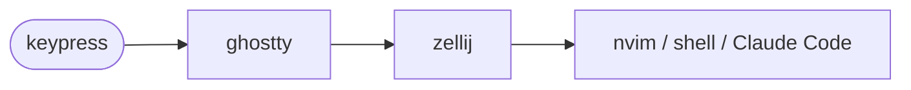

# <Title> — architecture

> Ticket: `<YYYY-MM-DD-HHmm>_<slug>` · Requirements: [feature.md](./feature.md)

## Overview

<The shape of the change in a few sentences, and a diagram when it helps: which layer owns the new
behaviour (terminal, multiplexer, editor, shell, agent) and how a keypress travels through them.>

## Structure

<Files added, changed or deleted, per tool folder. Mark new files.>

## Contracts

<What other config, scripts or the user depend on: the keys a layer takes or frees, a file another
tool reads, a script's arguments and exit codes, the installed version a key needs.>

## Seams

<Where a step's evidence is observed; a step's *Test first* names one. In a config repo a seam is
a validator in `scripts/check.sh`, a probe (a file or command that must fail before the change and
pass after), or a keypress with its expected result.>

| Seam | Catches | Misses |
|---|---|---|
| `<validator, probe or keypress>` | <what it proves> | <what it cannot see> |

## Decisions

<One entry per choice that is hard to reverse, surprising without context, and a real trade-off.
Each line of an entry is one or two sentences; a rejected alternative is kept only when someone
would propose it again.>

- **D1 — <the decision, in one line>.**
  - **Why:** <the reason>.
  - **Cost accepted:** <what this choice makes worse>.
  - **Reversal:** <one commit | irreversible: …>.
  - **Rejected:**
    - <alternative> — <why not>.

## Risks

<One entry per risk, in the order: what could go wrong → what it would cause → how the plan
contains it.>

- **<Risk, in one line>.** <What it would cause.> *Contained by:* <step, check or keypress>.
